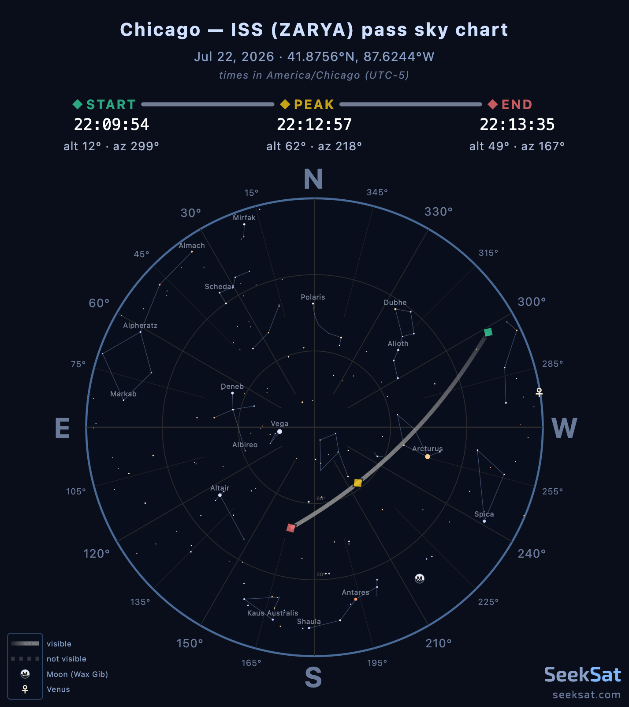

# SeekSat

**▶ Live: [seeksat.com](https://seeksat.com)**

The home screen shows what is overhead and coming up for your location,
and search takes you to a page for any satellite. Each satellite page
has live numbers, a ranked list of upcoming passes for radio or
watching, and a polar sky chart per pass with sun / moon / planet /
star context.



A multi-observer ray-triangulation tool also lives in this repo
(`components/TriangulateApp.tsx` + `lib/triangulate-scene.js`) for
verifying the math against recorded sightings. It's a local dev
tool, not wired up as a public route, and it still uses CesiumJS from the CDN. To run it locally: add a
one-line `app/triangulate/page.tsx` that imports `TriangulateApp`,
and supply your own observation sample data under `_data/`
(gitignored).

Built on Next.js (App Router) + React. SGP4 propagation via
`satellite.js`.

## MCP server

SeekSat is also an MCP server for AI agents: Streamable HTTP at
`https://seeksat.com/api/mcp`, no sign-in.

```sh
claude mcp add --transport http seeksat https://seeksat.com/api/mcp
```

Setup for Claude Desktop, claude.ai and Cursor, the optional API key header,
the rate limit (120 requests per 60 seconds per IP, a Vercel firewall rule)
and every tool's parameters are on [/mcp](https://seeksat.com/mcp) and in
[docs/seeksat-mcp.md](docs/seeksat-mcp.md). Tool definitions live in
`lib/mcp/tool-specs.mjs`; the handlers are in `lib/mcp/tools.mjs`.

## Run

```sh
npm install
npm run dev      # http://localhost:3000
```

Routes:
- `/` - home screen
- `/sat/<id>` - satellite pages
- `/sat/<id>/share/<blob>` - shared views
- `/mcp` - MCP docs
- `/api/*` - MCP, search, OG images and the catalog refresh

Production build:

```sh
npm run build && npm start
```

## Tests + type check

```sh
npm test         # 270+ Node-native unit tests (no jest)
npm run typecheck
```

Both run on every push + PR via `.github/workflows/ci.yml`.

## Pass-finder math

- Window search bisects observer visibility predicates (per-mode) on
  a coarse grid + refines to <1s resolution.
- Visual rating combines twilight, target altitude, and cloud-cover
  probability with explicit correlation-aware combiners (MIN across
  observers for sky-darkness + clouds, PRODUCT for altitude).
- Radio rating is peak-elevation × duration sigmoid.
- Polar plots draw the trajectory arc with magnitude-derived stroke
  opacity in visual mode, dashed where the satellite would be in
  Earth's shadow or the sky is too bright. Stars from a ~250-entry
  catalog, planets via truncated Keplerian elements, moon via
  low-precision Meeus lunar ephemeris.

## Triangulation math (offline tool)

- Each observation → a ray in ECEF (Earth-Centered, Earth-Fixed).
- RA/Dec ray directions: ECI → ECEF via GMST rotation.
- Alt/Az ray directions: ENU → ECEF via the observer's local frame.
- Bennett refraction correction applied to apparent altitudes.
- Closest point to all rays = least-squares minimizer of
  `Σ ‖(I - dᵢ dᵢᵀ)(x - pᵢ)‖²`, solved via a direct 3×3 inverse.
- Per-ray residuals (meters) reported per observation.
- Optional SGP4-propagated TLE truth comparison with miss-distance.

## Setting your location

The home screen takes your location from GPS, a place name, or a
Maidenhead grid square. Satellite pages let you check other places too.
Share buttons copy a link to the current view. Your places are saved in
localStorage.

## Architecture

- `lib/mirror` - the catalog snapshot (mirrored orbital data) the site reads.
- `lib/sat` + `lib/passes` - the pass engine and its worker, plus the
  numbers behind satellite pages.
- `lib/map` - the flat map drawing.
- `components/home` + `components/sat` - the home screen and satellite pages.
- `middleware.ts` - redirects legacy share links to satellite pages.
- Triangulate tool (local only) - `components/TriangulateApp.tsx` loads
  CesiumJS from the CDN through `components/CesiumLoader.tsx`.

## MCP server env vars

- `CRON_SECRET` - random string; Vercel Cron sends it as a Bearer token to `/api/refresh-tle`.
- `BLOB_READ_WRITE_TOKEN` - Vercel Blob token (auto-set when a Blob store is linked to the project). The cron writes the catalog snapshot to `catalog/snapshot.json.gz` and the site reads it back.
- `MCP_PRO_KEYS` - optional, comma-separated API keys for the `pro` tier (`lib/mcp/auth.mjs`). Callers send one as `Authorization: Bearer <key>` or `X-API-Key: <key>`. Nothing is gated today; leave it unset.

### Deploy order

1. Create a Blob store in the Vercel dashboard and link it to the project, so `BLOB_READ_WRITE_TOKEN` is set.
2. Set `CRON_SECRET` and deploy.
3. Run the cron once by hand so the snapshot exists before anyone needs it: in the Vercel dashboard, Project > Settings > Cron Jobs > Run. Or, from a machine that is not a developer laptop (CelesTrak blocks addresses that ask too often):

   ```sh
   curl -H "Authorization: Bearer $CRON_SECRET" https://seeksat.com/api/refresh-tle
   ```

   The route refreshes only on the production deployment; elsewhere it answers 403.

4. Check the JSON reply: `written` should be `true` and `objectCount` should be in the thousands. A 502 means no group could be fetched and nothing was written; `failedGroups` lists which ones.

After that the cron runs every 4 hours on its own.

`EDGE_CONFIG`, `EDGE_CONFIG_ID` and `VERCEL_API_TOKEN` are no longer used by this code. Leave them in place until production is verified on the Blob snapshot, since `main` still reads them and a rollback would need them; then remove them.

## Map data credits

The basemap tiles come from [OpenFreeMap](https://openfreemap.org/), built from [OpenStreetMap](https://www.openstreetmap.org/copyright) data. The map shows their attribution in its corner.

## License

Copyright (c) 2026 [Aaron Hanson](https://aaronhanson.dev). All rights reserved.

This source is published for viewing and reference. It is **not** licensed
for reuse, redistribution, or deployment. No permission is granted to copy,
modify, or run this code as a service. If you'd like to use any of it, reach
out.
